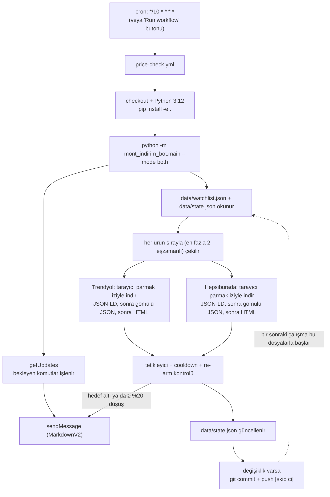

# mont-indirim-bot 🧥📉

**Sunucusuz Telegram fiyat takip botu.** Trendyol ve Hepsiburada'daki mont / outdoor giyim
ürünlerini izler, fiyat düştüğünde Telegram'dan haber verir. Hiçbir sunucu, VPS ya da
veritabanı gerekmez: bot **GitHub Actions** üzerinde 10 dakikada bir çalışır, işini bitirir,
durumu repoya geri commit eder ve kapanır.


---

## Ne yapar?

- 🔍 Trendyol ve Hepsiburada ürün sayfalarından **güncel fiyatı** okur (önce gömülü JSON /
  ürün endpoint'i, olmazsa HTML).
- 🎯 Fiyat, senin belirlediğin **hedef fiyatın altına indiğinde** haber verir.
- 📉 Önceki ölçüme göre **%20 ve üzeri düşüşlerde** haber verir (eşik ayarlanabilir).
- 🔁 Aynı ürün için **12 saatte en fazla bir bildirim** gönderir; fiyat tekrar yükselip
  yeniden düşmedikçe aynı indirimi ikinci kez bildirmez.
- 💬 Telegram'dan ürün ekleyip çıkarabilir, hedef fiyatı değiştirebilir, fiyat geçmişini
  görebilirsin (`/ekle`, `/liste`, `/sil`, `/esik`, `/gecmis`, `/kontrol`).
- 🧾 Fiyat geçmişi ve tüm durum `data/*.json` içinde, yani **repoda** tutulur ve her
  çalışmadan sonra otomatik commit edilir.

---

## Nasıl çalışır?



Sunucu olmadığı için botun "hafızası" repodur:

| Dosya                  | İçerik                                                                                   |
| ---------------------- | ---------------------------------------------------------------------------------------- |
| `data/watchlist.json`  | Takip edilen ürünler: id, link, site, ürün adı, hedef fiyat, ürün bazlı düşüş eşiği       |
| `data/state.json`      | Son fiyat, en düşük/en yüksek fiyat, fiyat geçmişi, bildirim cooldown'ı, Telegram offset  |

### Neden `httpx` değil `curl_cffi`?

İki site de Cloudflare arkasında ve TLS parmak izine bakarak karar veriyor: normal bir
HTTP istemcisi (`httpx`), tarayıcı başlıkları birebir gönderilse bile **403** alıyor.
Bu yüzden scraper'lar `curl_cffi` ile Chrome'un TLS/HTTP2 parmak izini taklit ederek
istek atıyor (`mont_indirim_bot/scrapers/http.py`). Testler ise ağa hiç çıkmaz; aynı
arayüzü sağlayan `httpx.MockTransport` istemcisi enjekte edilir.

Ayrıca her iki sitenin eski JSON ürün endpoint'i artık yanıt vermiyor
(`public.trendyol.com` DNS'te yok, Hepsiburada endpoint'i 404). Bu yüzden fiyat önce
sayfadaki `application/ld+json` bloğundan, sonra gömülü JS state'inden, en sonunda
HTML regex'lerinden okunur.

---

## Kurulum

### 1. Telegram bot token'ı ve chat id

1. Telegram'da [@BotFather](https://t.me/BotFather) ile konuş: `/newbot` → bot adı ve
   kullanıcı adını ver → sana `123456789:AA...` biçiminde bir **token** verir.
2. Kendi **chat id**'ni öğren: [@userinfobot](https://t.me/userinfobot) botuna `/start` yaz.
   Grup/kanal kullanacaksan id negatiftir (ör. `-1001234567890`) ve botu o gruba eklemen
   gerekir.
3. Bota bir kez `/start` yaz (Telegram botlar kullanıcıya ilk mesajı kendi başlatamaz).

### 2. Repo secret'ları

GitHub'da: **Settings → Secrets and variables → Actions → New repository secret**

| Ad                  | Zorunlu | Açıklama                                                     |
| ------------------- | ------- | ------------------------------------------------------------ |
| `TELEGRAM_BOT_TOKEN`| ✅      | BotFather'dan aldığın token                                  |
| `TELEGRAM_CHAT_ID`  | ✅      | Bildirimlerin gideceği chat; **komutlar sadece buradan kabul edilir** |
| `MIN_DISCOUNT_PCT`  | ➖      | Varsayılan `20`. İstersen secret yerine *Variables* olarak ekle |
| `COOLDOWN_HOURS`    | ➖      | Varsayılan `12`                                              |

> Not: `TELEGRAM_BOT_TOKEN` ve `TELEGRAM_CHAT_ID` yoksa iş akışı **kırmızı olur**
> (script 1 koduyla çıkar). Sessizce hiçbir şey yapmayan yeşil bir koşu olmaz.

### 3. Actions'ı etkinleştir

1. Repo → **Actions** sekmesi → "I understand my workflows, go ahead and enable them".
2. **price-check** iş akışını aç → **Run workflow** ile bir kez elle çalıştır ve logları gör.
3. İlk koşudan sonra `data/state.json` commit edilmiş olmalı; Telegram'a da bir test mesajı
   göndermek istersen bota `/kontrol` yaz (takip listesi boşsa uyarı verir).

### 4. (Opsiyonel) Takip listesini elle doldur

Telegram'ı beklemeden ürün eklemek için:

```bash
python scripts/seed_watchlist.py --url "https://www.trendyol.com/...-p-123456789" --price 1500
python scripts/seed_watchlist.py --file urls.txt        # satır satır link listesi
python scripts/seed_watchlist.py --file urls.txt --resolve   # ürün adını da şimdi çek
```

Sonra dosyayı commit'le: `git add data/watchlist.json && git commit -m "chore(data): seed watchlist"`

---

## Bot komutları

Komutlar yalnızca `TELEGRAM_CHAT_ID` ile eşleşen sohbetten kabul edilir; başka sohbetlerden
gelen mesajlar okunur ama **yok sayılır** (offset ilerletilir, cevap verilmez).

| Komut                        | Ne yapar                                                             |
| ---------------------------- | -------------------------------------------------------------------- |
| `/start`, `/yardim`          | Tanıtım ve komut listesi                                              |
| `/ekle <link> [hedef fiyat]` | Linki doğrular (host kontrolü), ürünü takibe alır, kısa id döner       |
| `/liste`                     | id, ürün adı, güncel fiyat, en düşük fiyat, zirveden düşüş yüzdesi      |
| `/sil <id>`                  | Ürünü takipten çıkarır (durumu ve geçmişi de silinir)                  |
| `/esik <id> <fiyat>`         | Hedef fiyatı günceller (hedef tetikleyicisi yeniden kurulur)           |
| `/gecmis <id>`               | Son 10 fiyat kaydını tarih tablosu olarak gösterir                     |
| `/kontrol`                   | Şimdi tarama yapar: indirim varsa bildirim + tek mesajda özet          |

Örnek:

```text
/ekle https://www.trendyol.com/columbia/pike-lake-mont-p-123456789 1500
/esik a1b2c3 1350
/gecmis a1b2c3
```

---

## Bildirim kuralları

```
her taramada:
  1) fiyat <= hedef fiyat            -> "hedef" tetikleyicisi
  2) (önceki fiyat - yeni fiyat) / önceki fiyat >= %20  -> "düşüş" tetikleyicisi

tetikleyici varsa:
  - son bildirimden bu yana 12 saat geçmediyse  -> bildirim gönderilmez (durum korunur)
  - gönderildiyse: cooldown başlar, ilgili tetikleyici "kurulmamış" sayılır
  - tetikleyici, fiyat son bildirim seviyesinin %2 üzerine çıktığında YENİDEN kurulur
```

Yani: fiyat hedefin altında kaldığı sürece her 12 saatte bir mesaj gelmez; ancak fiyat
yükselip tekrar düşerse yeni bir bildirim alırsın.

Bir ürün **3 kez üst üste** okunamazsa (site yapısı değişti, 403/429 engeli vb.) sahibe tek
seferlik bir uyarı mesajı gider.

Örnek bildirim:

```text
🚨 İNDİRİM 🚨

📦 Columbia Erkek Pike Lake Mont
🏪 Trendyol · ID: `a1b2c3`

💸 Eski fiyat: `1.799,00 TL`
✅ Yeni fiyat: *1.299,00 TL*
📉 Düşüş: %27,8
🎯 Hedef: `1.500,00 TL` · hedefin 201,00 TL altında
📊 En düşük: `1.299,00 TL`

🔗 Ürüne git
```

---

## Ortam değişkenleri

| Değişken                 | Varsayılan | Açıklama                                                     |
| ------------------------ | ---------- | ------------------------------------------------------------ |
| `TELEGRAM_BOT_TOKEN`     | –          | **Zorunlu.** BotFather token'ı                               |
| `TELEGRAM_CHAT_ID`       | –          | **Zorunlu.** Sahip sohbet id'si (negatif olabilir)           |
| `MIN_DISCOUNT_PCT`       | `20`       | Yüzde kaç düşüşte bildirim gelsin (`20` veya `20,5`)          |
| `COOLDOWN_HOURS`         | `12`       | Aynı ürün için iki bildirim arası minimum süre                |
| `REARM_PCT`              | `2`        | Bildirimden sonra tetikleyicinin yeniden kurulması için toparlanma |
| `REQUEST_MIN_DELAY_S`    | `2`        | İstekler arası rastgele gecikmenin alt sınırı                 |
| `REQUEST_MAX_DELAY_S`    | `6`        | İstekler arası rastgele gecikmenin üst sınırı                 |
| `MAX_RETRIES`            | `3`        | 403/429/5xx için toplam deneme sayısı (exponential backoff)    |
| `REQUEST_TIMEOUT_S`      | `20`       | Tek HTTP isteği zaman aşımı                                   |
| `MAX_PARALLEL_REQUESTS`  | `2`        | Aynı anda taranan ürün sayısı (siteyi yormamak için düşük tut) |
| `DATA_DIR`               | `data`     | Durum dosyalarının klasörü                                    |
| `LOG_LEVEL`              | `INFO`     | `DEBUG` / `INFO` / `WARNING`                                  |

---

## Yerel geliştirme

```bash
python -m venv .venv
.venv\Scripts\activate            # Windows
source .venv/bin/activate         # macOS / Linux
pip install -e ".[dev]"

cp .env.example .env              # token ve chat id'yi doldur

ruff check .                      # lint
ruff format --check .             # biçim
mypy                              # tip kontrolü (strict)
pytest                            # 32+ test, kaydedilmiş HTML/JSON fixture'larıyla
```

Botu elle çalıştırmak için ortam değişkenlerini ver:

```bash
python -m mont_indirim_bot.main --mode both       # komutlar + tarama
python -m mont_indirim_bot.main --mode check      # sadece tarama
python -m mont_indirim_bot.main --mode commands   # sadece Telegram komutları
python -m mont_indirim_bot.main --mode check --verbose
```

---

## Proje yapısı

```text
mont_indirim_bot/
  config.py            # ortam değişkenleri, doğrulama, exit 1 kuralı
  telegram_client.py   # httpx ile sendMessage / getUpdates (async, retry)
  scrapers/
    base.py            # Scraper arayüzü, PriceResult, HTTP + parsing ortak kodu
    trendyol.py        # fiyat alanları ve regex'ler TEK bir sabit bloğunda
    hepsiburada.py     # aynı yapı
  services/
    price_checker.py   # tarama, tetikleyici/cooldown/re-arm durum makinesi
    notifier.py        # MarkdownV2 escape + Türkçe mesaj formatları
    commands.py        # /ekle /liste /sil /esik /gecmis /kontrol
  storage.py           # data/*.json, atomik yazma (temp + os.replace)
  prices.py            # "1.299,00 TL" <-> 1299.0 tek yardımcı fonksiyon
  main.py              # --mode check|commands|both
data/                  # watchlist.json + state.json (repoda saklanır)
tests/                 # pytest + gerçek sayfalardan kaydedilmiş fixture'lar
.github/workflows/     # price-check.yml (cron) + ci.yml (lint/mypy/pytest)
scripts/seed_watchlist.py
```

### Site tasarımı değişirse

Tek bir yer güncellenir: `mont_indirim_bot/scrapers/trendyol.py` veya `hepsiburada.py`
içindeki sabitler (`JSON_PRICE_KEYS`, `HTML_PRICE_PATTERNS`, `embedded_json_vars` …).
Ayrıştırma mantığı `scrapers/base.py` içinde tek bir yerde durur. Bir ürün okunamazsa
sadece o ürün "error" sayılır, koşu devam eder ve 3 hatadan sonra Telegram'dan uyarı alırsın.

---

## Sınırlamalar

- ⏱ **GitHub cron en iyi çaba ile çalışır.** `*/10 * * * *` yazsa da yoğun saatlerde
  tetikleme 10-20 dakika gecikebilir; en küçük periyot 5 dakikadır. Fiyat takibi için
  yeterlidir ama "saniyesinde yakala" beklentisiyle kullanılmamalıdır.
- 😴 **60 gün hareketsiz kalan repolarda zamanlanmış iş akışları otomatik durur.** Durumu
  `data/` klasörüne commit'lediğimiz için bot her çalıştığında repo "hareket" görür; yine de
  uzun tatillerde Actions sekmesinden **Run workflow** ile uyandırmak gerekebilir.
- 💸 **Public repolarda Actions dakikaları ücretsizdir.** Private repolarda aylık ücretsiz
  kota vardır; 10 dakikalık bir cron bu kotayı hızlı tüketir, botu public repoda tutmak
  veya periyodu artırmak daha uygundur.
- 🔁 Aynı anda tek koşu çalışır (`concurrency: price-check`), yani üst üste binme olmaz.
- 🧱 Bazı ürünler bot koruması (403) ya da stok dışı durumu nedeniyle okunamayabilir;
  bu durumda ürün hata olarak işaretlenir ve sahibine bildirilir.
- ☁️ Cloudflare, GitHub Actions'ın veri merkezi IP'lerini zaman zaman engelleyebilir.
  Böyle bir durumda tarama loglarında `HTTP 403` görürsün; birkaç saat sonra tekrar
  denemek genelde yeterlidir.
- 🏷 Trendyol stokta olmayan ürünler için fiyat alanına `999.999 TL` yer tutucusu yazar.
  Bu yüzden watchlist'e **stokta olan** ürünleri eklemek daha sağlıklıdır (tükenen bir
  ürün stokta dönerse gerçek fiyatıyla güncellenir).
- 🚫 Fiyatlar site tarafında "liste fiyatı / indirimli fiyat" olarak farklı gösterilebilir;
  bot ödeme adımındaki kupon/kargo etkisini **hesaba katmaz**.

---

## Yasal not

Bu bot, herkese açık ürün sayfalarından fiyat okur. Kazıma, ilgili sitelerin **kullanım
koşullarına ve robots kurallarına** tabidir; sorumluluk kullanıcıdadır. Proje bunu
kolaylaştırmak için:

- istekler arasına **rastgele 2-6 saniye gecikme** koyar,
- aynı anda en fazla **2 ürün** tarar,
- 403/429 yanıtlarında **exponential backoff** uygular,
- mümkün olan her yerde **resmî/gömülü JSON** kaynaklarını HTML ayrıştırmaya tercih eder.

Ticari kullanım, yüksek frekanslı tarama veya sitelerin kendi API'si varsa **öncelikle onu
kullanmak** senin sorumluluğundadır. Sadece kendi ihtiyacın için, düşük hızda çalıştır.

---

## Lisans

[MIT](LICENSE)
